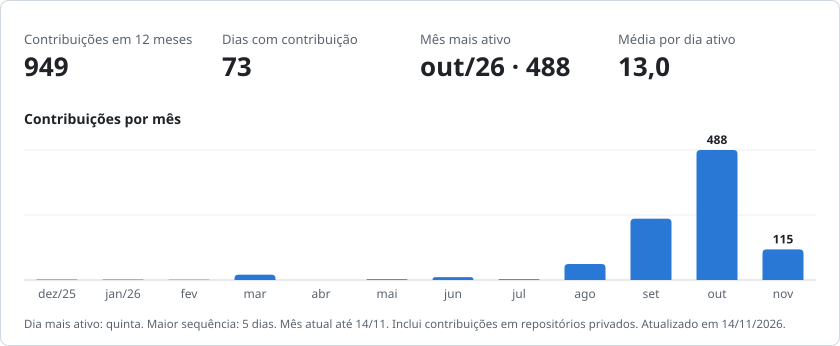

# Davi Specia

Analista de dados, com foco em engenharia de dados e IA. Python, SQL, Databricks e Power BI.

Bacharelando em Inteligência Artificial na Faculdade Donaduzzi (Biopark). Moro em Palotina, PR, e tenho disponibilidade imediata.

           

<picture>
  <source media="(prefers-color-scheme: dark)" srcset="https://raw.githubusercontent.com/davispecia/davispecia/output/cartao-escuro.svg">
  
</picture>

## Experiência

**Alugaix, sócio-fundador e analista de dados (out/2023 a nov/2026).** Fui responsável pela área de dados de uma gestora de 60 imóveis por temporada em Toledo e região. Construí a camada analítica (ingestão via API do PMS, indicadores de ocupação, ADR e RevPAR), os painéis de BI da empresa e o Compacta, ferramenta interna que monta anúncios a partir das fotos e dos documentos do imóvel.

## Projetos

**[Cinerd](https://cinerd.davispecia.com.br)**: busca de filmes por descrição, em produção. Catálogo de 22.029 títulos, busca híbrida com 8 sinais (BM25, embeddings multilíngues e5-large, nome de personagem, popularidade) normalizados por z-score. No conjunto de teste, nDCG@10 de 0,829 contra 0,360 do BM25 sozinho. Testei um cross-encoder e tirei da produção, porque o ganho ficou dentro do ruído e a latência aumentou cerca de 40 vezes. Deploy na Oracle Cloud, com DVC, CI e métricas em Prometheus.
`Python` `sentence-transformers` `ONNX Runtime` `DVC` `Docker` `Prometheus`

**[Pipeline de análise de crédito](https://github.com/davispecia/pipeline-analise-credito)**: arquitetura medalhão no Databricks, job serverless de 6 tarefas com Databricks Asset Bundles, tabelas Delta no Unity Catalog, carga incremental com MERGE INTO e quality gate com 20 regras. A mesma lógica roda localmente com PostgreSQL e Airflow, com mais de 40 testes.
`Databricks` `PySpark` `Delta Lake` `Airflow` `PostgreSQL`

**[Rede neural guiada por física para Itaipu](https://github.com/davispecia/PGNN_itaipu)**: implementada do zero em Rust, com retropropagação e Adam escritos à mão, sobre dados do ONS de 2015 a 2024. Na ablação, o modelo sem o termo físico errou menos nos dados, mas teve resíduo físico cerca de 33 vezes maior. O cenário operacional chegou a RMSE de 508 MWmed (R² de 0,91) e superou a persistência em todos os anos da validação de 2020 a 2024.
`Rust` `Physics-Guided ML`

## Publicações

- Modelagem da geração hidrelétrica de Itaipu via redes neurais guiadas por física em Rust. Latin.Science 2026, Latinoware (artigo aprovado).
- Estimativa de peso de suínos a partir de imagens RGB utilizando redes neurais convolucionais. [RECIMA21, 2026](https://recima21.com.br/recima21/pt_BR/article/view/8496).

## Prêmios

- 1º lugar no Hackathon da Semana Acadêmica de Tecnologia da Faculdade Donaduzzi, com o MobIA (mai/2026).
- 3º lugar no Hackatour Cataratas, como líder e analista de dados do TripData (abr/2026).

<picture>
  <source media="(prefers-color-scheme: dark)" srcset="https://raw.githubusercontent.com/davispecia/davispecia/output/cobrinha-escura.svg">
  
</picture>

O cartão e a cobrinha são atualizados todo dia por um workflow deste repositório (<code>scripts/cartao.py</code>), a partir da API do GitHub.
